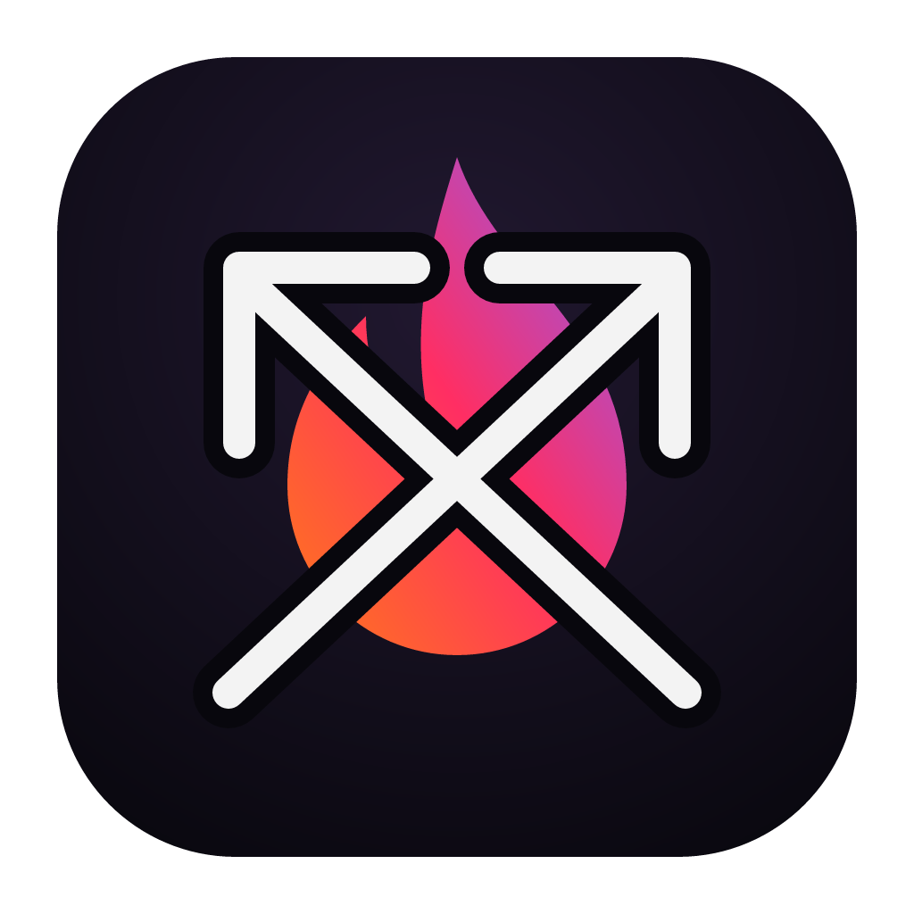

[](https://sourceforge.net/projects/ahg-crossfire/files/latest/download) [](https://sourceforge.net/projects/ahg-crossfire/files/latest/download)

[](https://github.com/A-Hackers-Guide/crossfire/actions/workflows/build.yml)
[](https://github.com/A-Hackers-Guide/crossfire/actions/workflows/lint.yml)
[](https://a-hackers-guide.github.io/crossfire/)

<p align="center">
  
</p>

<h1 align="center">Crossfire</h1>

<p align="center"><b>Port any project between Windows, macOS, Linux and FreeBSD.</b><br>
Point it at your source code. It maps every OS-specific call, asks a few questions, writes a portable version, and builds it.</p>

> 📘 Full docs: <https://a-hackers-guide.github.io/crossfire/>

---

## What it does

1. **Source** — pick a project folder. Say which OS it was written for, or let Crossfire detect.
2. **Analyze** — scans every file against **705 rules** covering Win32, DirectX, Cocoa/Metal, X11/Wayland, ALSA/PulseAudio, kqueue/epoll, registry, filesystem paths, threading, timing, language-level APIs (C#, Python, Go, Rust, Java, Node), and game engines (Unity, Unreal, Godot, Love2D). You get a portability score, a heat map, and a suggested replacement for every finding per target OS.
3. **Targets** — pick any of Windows, macOS, Linux, FreeBSD.
4. **Configure** — questions based on what was found: porting strategy (SDL3 portability layer, native per OS, translation layer, hybrid), graphics + audio backends, build system, C++ standard, packaging, CI, AI.
5. **Convert** — writes a new copy; never touches the original. Mechanical rule-based rewrites + a portability shim + CMake/CI/packaging + optional AI pass for the hardest files + `CROSSFIRE_REPORT.md` of every change.
6. **Build** — builds each target this machine can produce (native + MinGW + zig cross). The rest build in CI with the generated workflow.
7. **Test** — on macOS, run the Windows build through Apple's Game Porting Toolkit from the app.

## The promises

Each of these is a claim about what the tool and the repo actually do **today**, backed by code and CI that landed in this session's PRs #1-#3.

### Conversion

1. **705 rules** across 9 TOML tables (`win32`, `directx`, `macos`, `linux`, `bsd`, `posix`, `languages`, `engines`, `build`). `crossfire-engine rules | jq length` confirms the count.
2. **All four target OSes** (Windows, macOS, Linux, FreeBSD) convertible from any source OS.
3. **Deterministic mechanical rewrites** for the cases where the target has a direct replacement (sleep, timers, aligned alloc, path separators, include guards).
4. **Per-file portability score + heat map** shipped in the `ScanReport` JSON.
5. **Per-finding severity** (`block` / `warn` / `info`) drives both the heat map and whether Convert stops to ask.
6. **Portability shim** (`crossfire/cf_platform.h`) emitted per convert.
7. **Generated CMake + presets + packaging + 4-OS GitHub Actions workflow.**
8. **Optional AI pass** with pluggable providers (Claude or any OpenAI-compatible endpoint, including local models).
9. **AI confidence gate** — diffs below a configurable threshold are refused, not applied.
10. **`CROSSFIRE_REPORT.md`** per convert listing every change and what needs human review.

### Analyze depth

11. **Language-aware scanning** — rules carry a language scope (`c` / `cpp` / `cs` / `python` / `go` / `rust` / `java` / `node`).
12. **Game-engine aware** — dedicated rule groups for Unity, Unreal, Godot, Love2D.
13. **Build-system aware** — rules for CMake, Meson, MSBuild, Makefile, Cargo, npm.
14. **Project-type detection** — detects source OS and project kind before you have to say.
15. **Streaming progress events** so UIs don't freeze on large trees (`ProgressEvent` JSON on stderr for the CLI).

### Build + test

16. **Toolchain detector** enumerates compilers, cross-compilers, build tools, package tools, runtimes, and translation layers.
17. **Zig cross-compile** path for Windows / Linux / FreeBSD targets from Linux or macOS hosts.
18. **MinGW cross-compile** path for Windows targets from Linux or macOS hosts.
19. **Game Porting Toolkit runner** for smoke-testing Windows builds on macOS from the app.
20. **Wine runner fallback** when GPTK isn't available.

### Output

21. **Stable JSON contract** for every engine command (`ScanReport`, `Question`, `ConvertRequest/Result`, `BuildRequest/Result`, `Toolchain`, `Finding`, …) with `serde` `rename_all = "camelCase"`.
22. **Headless CLI** mirrors every GUI action (`crossfire-engine scan | questions | convert | build | toolchains | gptk | rules | host`).
23. **CI-grade exit codes** (0 success, 1 runtime, 2 usage, 3 partial).

### GUI

24. **Tauri main app** (one binary per target, system webview, native file dialogs).
25. **Electron backup app** for hosts where Tauri's webview is a problem.
26. **Shared React UI** — both shells render the same `ui/` bundle.
27. **Dark + light theme**, driven by the system preference.

### Safety

28. **Read-only on the input.** Convert never writes inside the source tree.
29. **No cloud required.** Rule-based rewrites run entirely locally; AI is opt-in.
30. **API key handling** — `CROSSFIRE_AI_KEY` is held in memory for the convert, never written to the project file or logged.
31. **No implicit network calls** outside the explicit AI pass.
32. **cargo-deny** in CI rejects unknown licenses, unknown registries, git-sourced crates, yanked versions.

### CI quality gates (`.github/workflows/lint.yml`)

33. **`cargo fmt --check`** — no style drift.
34. **`cargo clippy --all-targets -- -D warnings`** — warnings fail PRs.
35. **`cargo-deny check`** — supply chain policy (advisories + bans + licenses + sources).
36. **`oxlint`** on the UI.
37. **`tsc -b --noEmit`** on the UI.
38. **3-OS engine test matrix** (Linux + macOS + Windows).

### Portability

39. **Native build** on all four target OSes (Linux, macOS, Windows, FreeBSD).
40. **Universal macOS build** (`aarch64` + `x86_64` in one `.app`).
41. **MSBuild + MinGW + clang-cl** supported on Windows.

### Docs

42. **Pages site** at <https://a-hackers-guide.github.io/crossfire/>.
43. **13 doc pages** (install, first-port, CLI, rules, writing-rules, target-matrix, shim, build, toolchains, AI, architecture, FAQ, index) built with `mkdocs --strict`.
44. **Rule catalog documented** — tables, categories, severity, output format.
45. **Rule authoring guide** — schema, fixtures, style, lint gates.

### Correctness

46. **34+ engine tests**, exercised on 3 OSes per PR.
47. **End-to-end convert fixtures** per target OS under `engine/tests/fixtures/`.
48. **Serde schema sanity test** (`assert!(rule_count() >= 250)` et al.) so a parse regression on the TOML tables fails CI.
49. **Progress callback-driven** so a stuck sub-step is observable, not a silent hang.

### License

50. **MIT.** All code under this repo is MIT; the engine's transitive dependencies are limited to MIT / Apache-2.0 / BSD / ISC / MPL-2.0 / BSL / CC0 / Unicode / Zlib / CDLA-Permissive-2.0 by cargo-deny policy.

## Download

| OS | Main app (Tauri) | Backup app (Electron) |
|---|---|---|
| Windows | `.exe` installer / `.msi` | `.exe` installer + portable `.exe` |
| macOS | `.dmg` / `.app` (universal) | `.dmg` |
| Linux | `.AppImage` / `.deb` / `.rpm` | `.AppImage` |
| FreeBSD | binary tarball (`crossfire` + `crossfire-engine`) | — |

Grab the build from [Releases](https://github.com/A-Hackers-Guide/crossfire/releases).

The engine also runs headless:

```sh
crossfire-engine scan ./MyGame > scan.json
crossfire-engine questions scan.json --targets linux,macos,freebsd
crossfire-engine convert request.json
crossfire-engine build build.json
crossfire-engine toolchains
```

## How it's built

```
crossfire/
├── ui/                        React + TypeScript GUI (shared by both shells)
├── engine/                    Rust engine
│   ├── src/                     scan, rules, questions, convert, AI, toolchains, build, GPTK
│   └── src/rules/*.toml         9 tables, 705 rules
├── apps/tauri/                Main app: Tauri 2, engine linked in-process
├── apps/electron/             Backup app: Electron, engine runs as a sidecar CLI
└── .github/workflows/
    ├── build.yml                Builds + packages + releases
    ├── lint.yml                 fmt + clippy + deny + oxlint + tsc
    └── docs.yml                 mkdocs + Pages
```

Three ways to run the same engine: the Tauri app, the Electron app, and the CLI.

## Developing

Requires Node 22+ and Rust (stable).

```sh
npm --prefix ui install
npm --prefix ui run dev                 # GUI in the browser with the demo engine

cargo fmt --manifest-path engine/Cargo.toml
cargo clippy --manifest-path engine/Cargo.toml --all-targets -- -D warnings
cargo test --manifest-path engine/Cargo.toml

cd apps/tauri && npm install && npx tauri dev     # native app
cd apps/electron && npm install && npm start      # backup app
```

On Linux, Tauri needs `libwebkit2gtk-4.1-dev librsvg2-dev patchelf`.

## Honest limits

Crossfire automates the bulk of a port, not 100% of it.

- APIs with no portable equivalent (a closed-source Windows-only `.dll`, kernel drivers, anti-cheat) are flagged, not converted.
- Graphics rewrites (DirectX → SDL_GPU/Vulkan/Metal) and UI-toolkit changes (WinForms → Avalonia, Cocoa → cross-platform) rely on the AI pass and need review.
- Building a macOS app requires a Mac (Apple's SDK license); the CI workflow uses GitHub's macOS runners for this.
- Unity, Unreal and Godot projects are analyzed and converted, but should be exported from their editors.
- Zig and Docker builds are implemented but less tested than native builds.

The report always says what was converted, how confident it is, and what you need to check.

## License

MIT. See [`LICENSE`](LICENSE).
